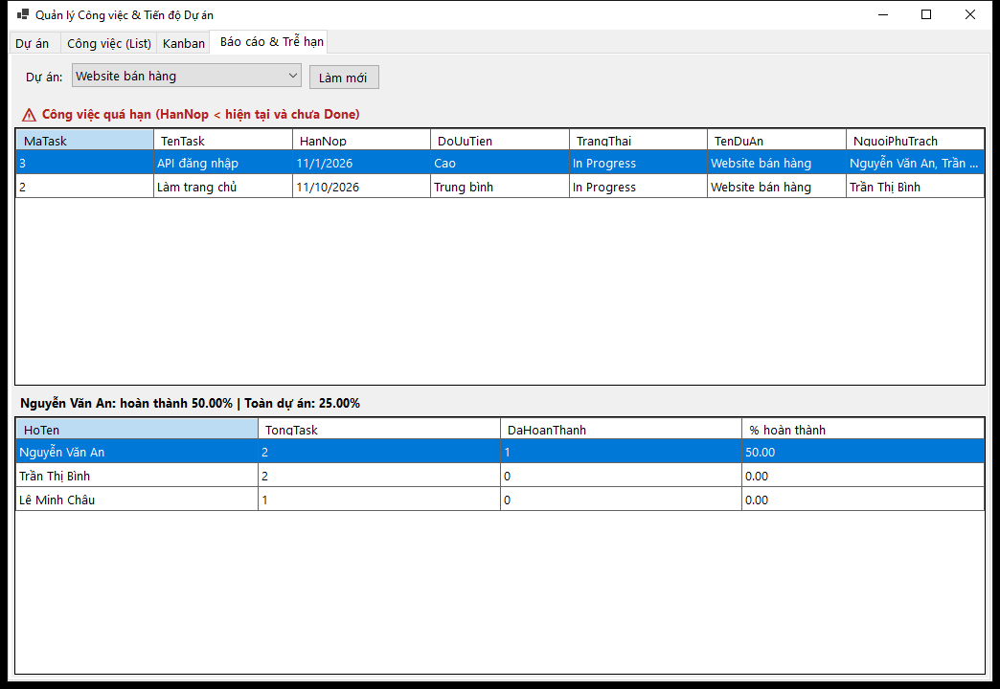
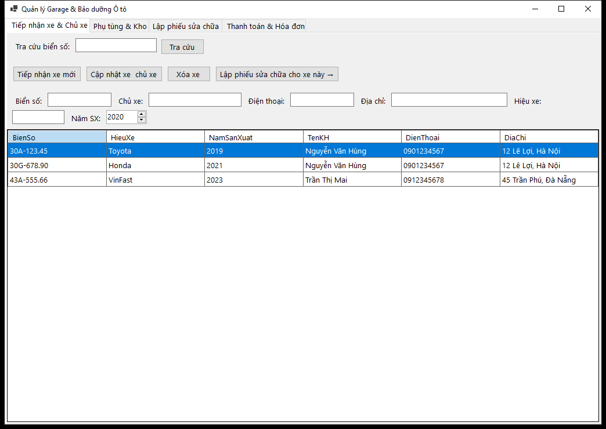
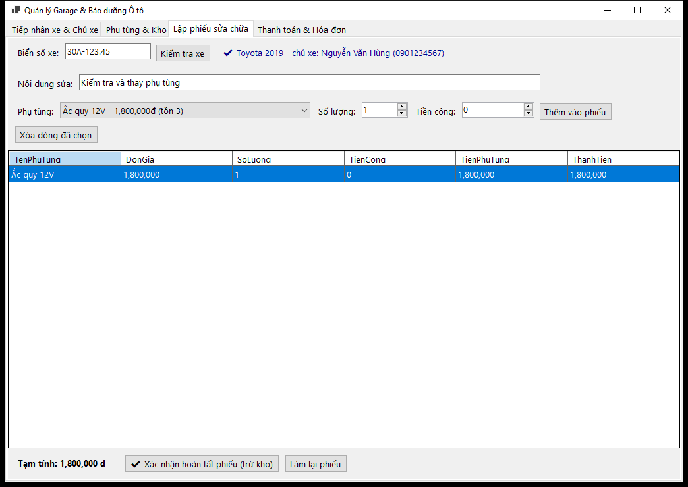
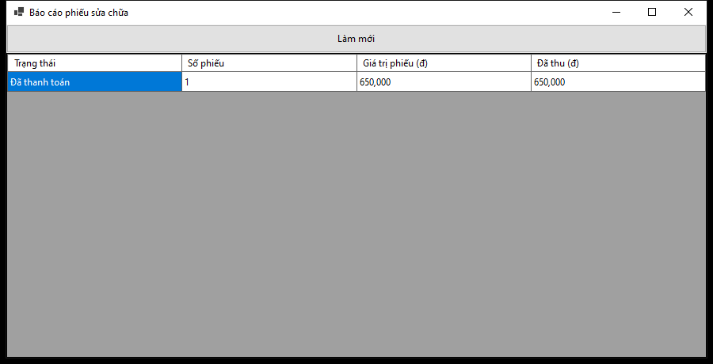
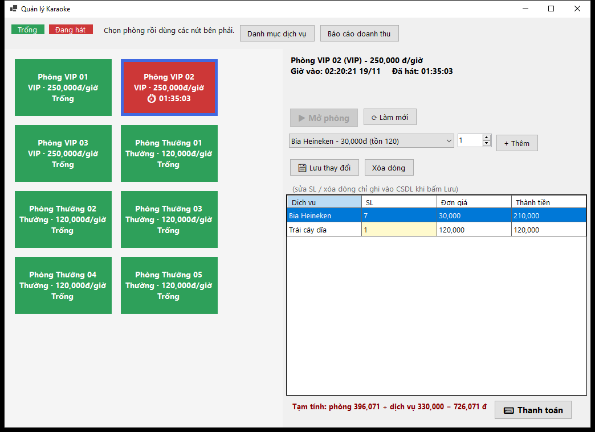
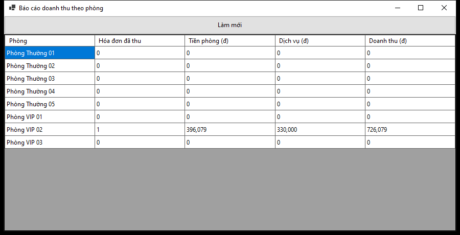
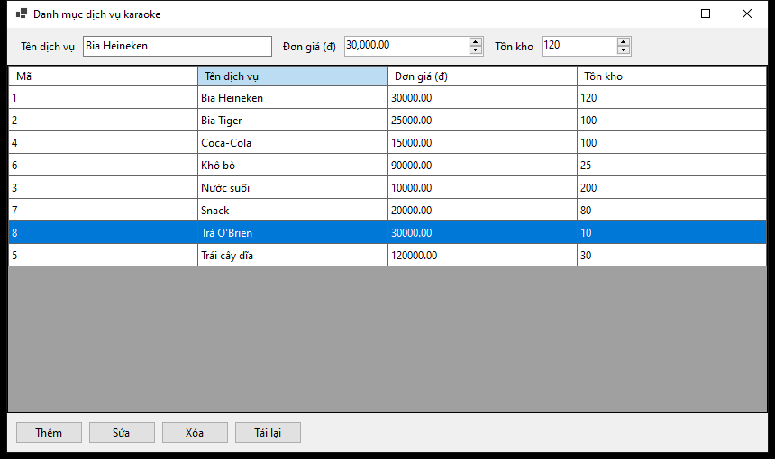

## Mục 1. Thông tin sinh viên

| Họ và tên | Mã sinh viên | Lớp / Khóa |
| --- | --- | --- |
| Ngô Trung Chiến | 24810310198 | D19CNPM3 |

## Mục 2. Hình ảnh kết quả các màn hình chức năng

### Bài 6.3. Quản lý công việc và tiến độ dự án

#### 1. Màn hình chính

#### 2. Quản lý danh mục (CRUD)

#### 3. Thực thi nghiệp vụ chính

#### 4. Báo cáo – Thống kê

#### 5. An toàn dữ liệu

### Bài 6.4. Quản lý garage và bảo dưỡng ô tô

#### 1. Màn hình chính

#### 2. Quản lý danh mục (CRUD)

#### 3. Thực thi nghiệp vụ chính

#### 4. Báo cáo – Thống kê

#### 5. An toàn dữ liệu

### Bài 6.5. Quản lý phòng karaoke

#### 1. Màn hình chính

#### 2. Quản lý danh mục (CRUD)

#### 3. Thực thi nghiệp vụ chính

#### 4. Báo cáo – Thống kê

#### 5. An toàn dữ liệu

