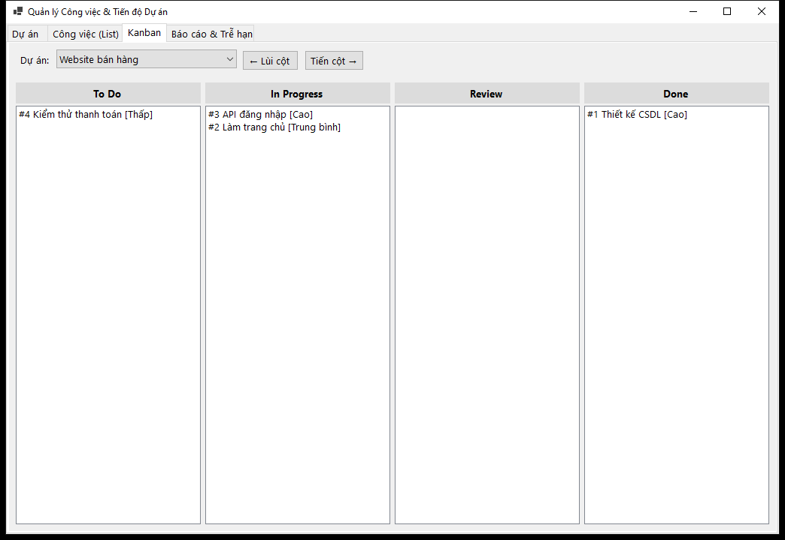
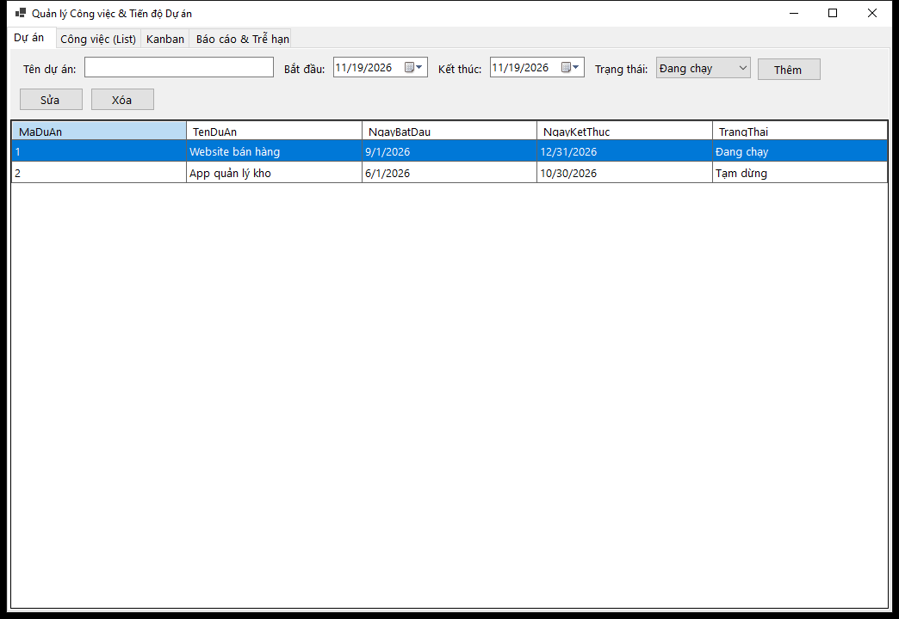
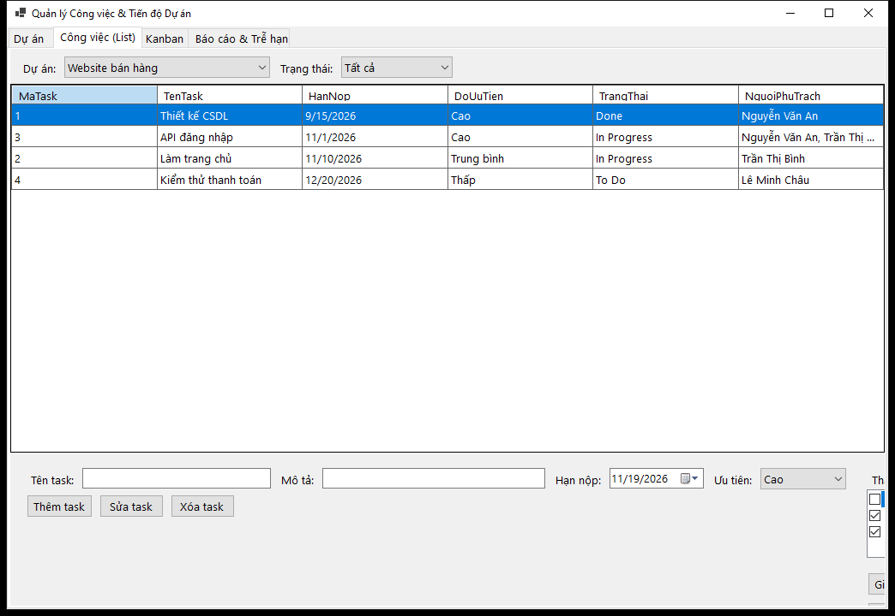
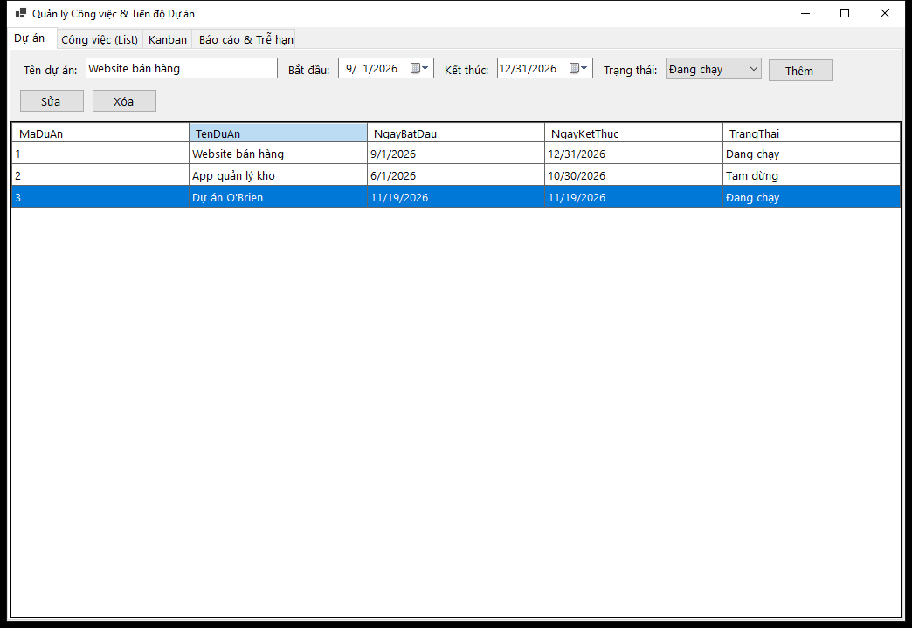
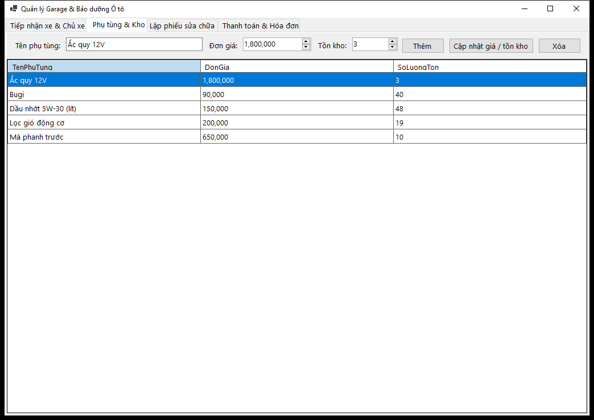
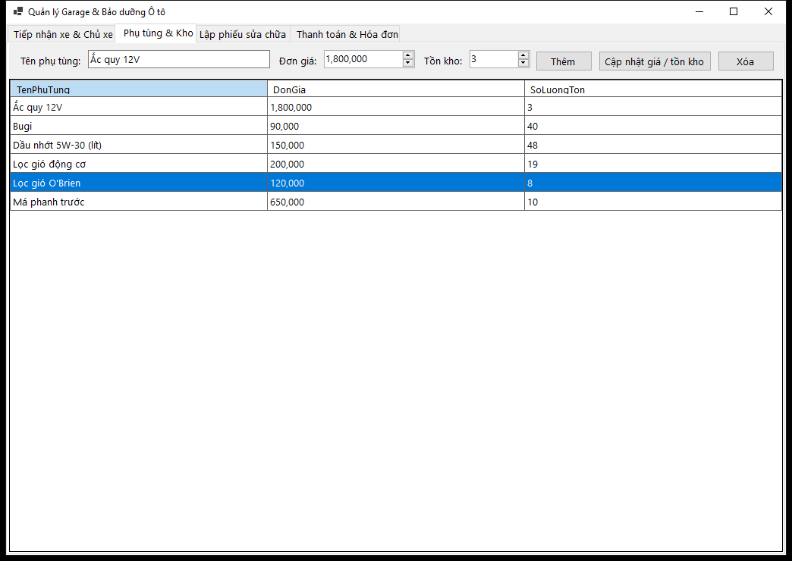
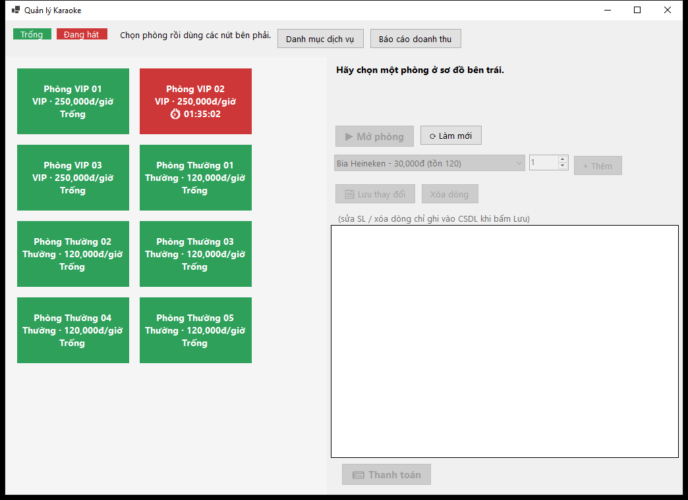
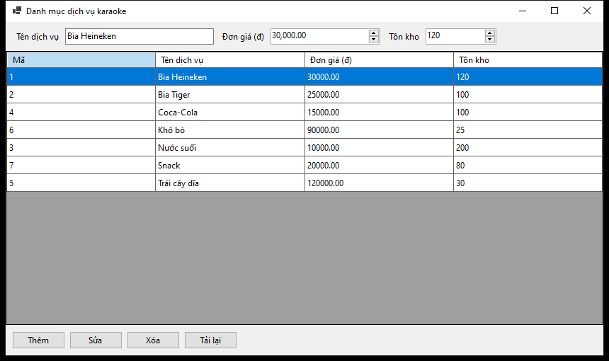

# Bài thực hành C# WinForms · Bài 6.3–6.5

## Mục 1. Thông tin sinh viên

| Họ và tên | Mã sinh viên | Lớp / Khóa |
| --- | --- | --- |
| Ngô Trung Chiến | 24810310198 | D19CNPM3 |

## Mục 2. Hình ảnh kết quả các màn hình chức năng

### Bài 6.3. Quản lý công việc và tiến độ dự án

#### 1. Màn hình chính

Bảng Kanban nhóm công việc theo trạng thái của dự án đang chọn.

#### 2. Quản lý danh mục (CRUD)

Danh mục dự án hiển thị thời hạn, trạng thái và các thao tác thêm, sửa, xóa.

#### 3. Thực thi nghiệp vụ chính

Nhân viên phụ trách được đánh dấu trong danh sách thành viên sau khi giao việc.

#### 4. Báo cáo – Thống kê

Báo cáo tổng hợp công việc trễ hạn và tỷ lệ hoàn thành của từng thành viên.

#### 5. An toàn dữ liệu

Tên dự án `Dự án O'Brien` được lưu và đọc lại. Phương thức DuAnDAL.Insert truyền tên qua tham số `@ten`.

### Bài 6.4. Quản lý garage và bảo dưỡng ô tô

#### 1. Màn hình chính

Màn hình tiếp nhận liên kết biển số xe với thông tin chủ xe.

#### 2. Quản lý danh mục (CRUD)

Danh mục phụ tùng hiển thị đơn giá và số lượng tồn, hỗ trợ thêm, cập nhật và xóa.

#### 3. Thực thi nghiệp vụ chính

Phiếu sửa chữa hiển thị xe, phụ tùng, tiền công và số tiền tạm tính trước khi xác nhận.

#### 4. Báo cáo – Thống kê

Từ Thanh toán & Hóa đơn, chọn Báo cáo thống kê để xem số phiếu, giá trị và số tiền đã thu theo trạng thái.

#### 5. An toàn dữ liệu

Khi số lượng phụ tùng vượt tồn kho, giao dịch lập phiếu bị hủy. Công cụ chụp kiểm tra số phiếu trước và sau thao tác.

### Bài 6.5. Quản lý phòng karaoke

#### 1. Màn hình chính

Sơ đồ phòng thể hiện trạng thái trống hoặc đang hát, loại phòng và giá theo giờ.

#### 2. Quản lý danh mục (CRUD)

Danh mục dịch vụ hỗ trợ thêm, sửa, xóa tên, đơn giá và tồn kho. Dịch vụ đã xuất hiện trong hóa đơn được bảo vệ bởi khóa ngoại.

#### 3. Thực thi nghiệp vụ chính

Gọi thêm dịch vụ cho phòng đang hát sẽ cập nhật chi tiết hóa đơn và số tiền tạm tính.

#### 4. Báo cáo – Thống kê

Báo cáo doanh thu liệt kê số hóa đơn đã thu, tiền phòng, tiền dịch vụ và doanh thu theo từng phòng.

#### 5. An toàn dữ liệu

Gọi dịch vụ vượt số lượng tồn sẽ kích hoạt rollback và thông báo tên dịch vụ thiếu hàng.

## Cấu trúc và cách chạy

Solution [BaiThucHanh.sln](BaiThucHanh.sln) gồm ba ứng dụng độc lập. Mỗi project có các thư mục DTO, DAL, BUS và GUI. DAL dùng ADO.NET để truy vấn SQL Server.

| Bài | Project | Cơ sở dữ liệu |
| --- | --- | --- |
| 6.3 | ProjectTaskManager | ProjectTaskDB |
| 6.4 | GarageManager | GarageDB |
| 6.5 | KaraokeManager | KaraokeDB |

1. Trên Windows, dùng SSMS mở [Database/ScriptDB.sql](Database/ScriptDB.sql). Chạy một lần trên SQL Server chưa có ba cơ sở dữ liệu nêu trên để tạo bảng và nạp dữ liệu mẫu.
2. Mở solution trong Visual Studio với workload **.NET desktop development** và .NET 8 SDK. Khôi phục gói NuGet.
3. Mặc định các project kết nối tới `.\SQLEXPRESS` bằng Windows Authentication. Nếu dùng instance khác, chỉnh `Server` trong `DAL/DbHelper.cs` của từng project.
4. Nhấp chuột phải vào project muốn chạy trong Solution Explorer, chọn **Set as Startup Project**, rồi nhấn **F5**.

## Tạo ảnh chạy thực tế

Khi tải đầy đủ thư mục lên nhánh mặc định, workflow trong `.github/workflows/chup-anh.yml` sẽ biên dịch các project trên Windows, chạy với SQL Server Express LocalDB riêng và ghi 5 ảnh PNG cho mỗi bài. Các ảnh sẽ xuất hiện ở trên sau khi workflow hoàn tất và đẩy được commit ảnh. Theo dõi ở **Actions → Chụp 15 màn hình WinForms**. Nếu nhánh chặn commit tự động, tải artifact **Anh-WinForms** của lần chạy rồi giải nén vào thư mục `images/`.

Để chụp trên Windows cá nhân có .NET 8 SDK và SQL Server Express LocalDB, mở PowerShell tại thư mục chứa solution và chạy `.\ChupAnh.ps1`. Dữ liệu chụp được tạo trong instance tạm. Quy trình chỉ thay các ảnh trong `images/` khi chụp xong cả ba bài.
